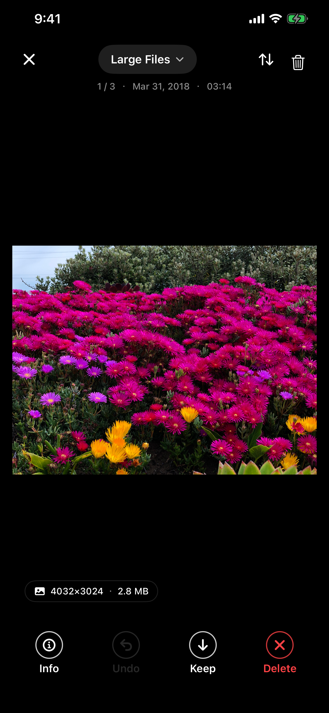
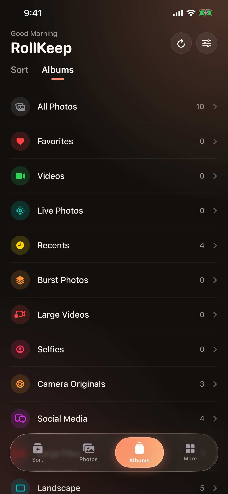
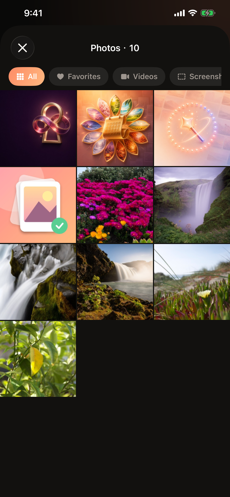

<p align="center"></p>

<h1 align="center">RollKeep · PhotoCleaner</h1>

<p align="center"><a href="README.md">English</a> · <a href="README.zh.md">中文</a> · <a href="README.ja.md">日本語</a> · <a href="README.ko.md">한국어</a></p>

iPhone、iPad、iPhone Duo 向けの無料オープンソース写真整理アプリ。SwiftUI ネイティブで、サブスクリプション、アプリ内課金、利用上限はありません。

> RollKeep の開発、ソースコード、Issue、リリース、公式サイトは、このリポジトリに統合されました。


## 機能

- 左スワイプで次へ、右で前へ、上で削除予定に追加。
- 削除予定リストは無制限。選択を取り消せて、削除には Apple Photos の確認が必要です。
- 全画面表示、ズーム、お気に入り、共有、メタデータ表示。
- スマート分類、容量順の並べ替え、すべての月のタイムライン。
- 端末内の整理統計、推定解放容量、連続日数、過去七日間の傾向。
- ウィンドウ幅に合わせてホームの列数、写真グリッド、確認画面を調整。
- 五つのテーマと 14 言語の選択肢。地域言語の未翻訳部分は英語で表示。
- 写真とメタデータは端末上で処理され、アプリからアップロードされません。

## ビルドと実行

Xcode 26 以降と iOS Simulator ランタイムが必要です。実機では自分の署名チームを選択してください。iPhone Duo の検証には互換性のある iOS 27 ランタイムを使用します。

```bash
git clone https://github.com/ZanwingMak/PhotoCleaner.git
cd PhotoCleaner
open PhotoCleaner.xcodeproj
```

## 未署名 IPA のビルド

`build/` に未署名 IPA を出力します。実機へのインストールには署名が必要です。

```bash
bash scripts/build-ipa.sh
```

## スクリーンショット

<p align="center">
  
  
  
</p>

画面のプレビュー。現在のソースには整理インサイトと可変レイアウトも含まれます。

## プロジェクト構造

- `PhotoCleaner/` — SwiftUI app, Photos services, and localizations.
- `PhotoCleaner.xcodeproj/` — Xcode project.
- `docs/` — GitHub Pages website, privacy policy, and terms.
- `scripts/` — Build and icon generation utilities.

## プライバシー

写真へのアクセスは許可後に行い、削除には Apple Photos の確認が必要です。設定と統計は端末内に保存されます。更新確認の GitHub Releases API 通信には写真や写真メタデータを含めません。

## リンク

- [ソースコード](https://github.com/ZanwingMak/PhotoCleaner)
- [公式サイト](https://zanwingmak.github.io/PhotoCleaner/)
- [プライバシーポリシー](https://zanwingmak.github.io/PhotoCleaner/privacy.html)
- [利用規約](https://zanwingmak.github.io/PhotoCleaner/terms.html)
- [リリース](https://github.com/ZanwingMak/PhotoCleaner/releases)
- [Issue とフィードバック](https://github.com/ZanwingMak/PhotoCleaner/issues)
- [CHANGELOG](CHANGELOG.md)

## ライセンス

GPL-3.0-only。全機能が無料で、任意の寄付で機能が変わることはありません。 [LICENSE](LICENSE)
