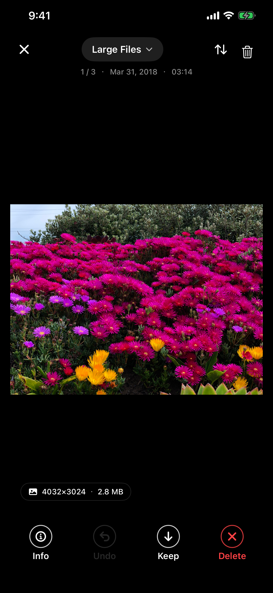
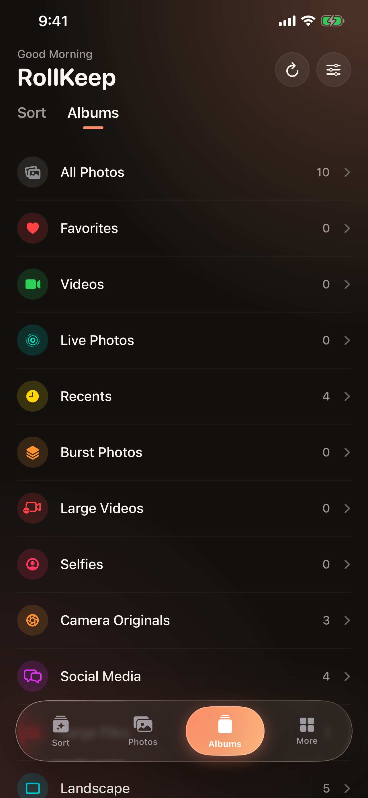
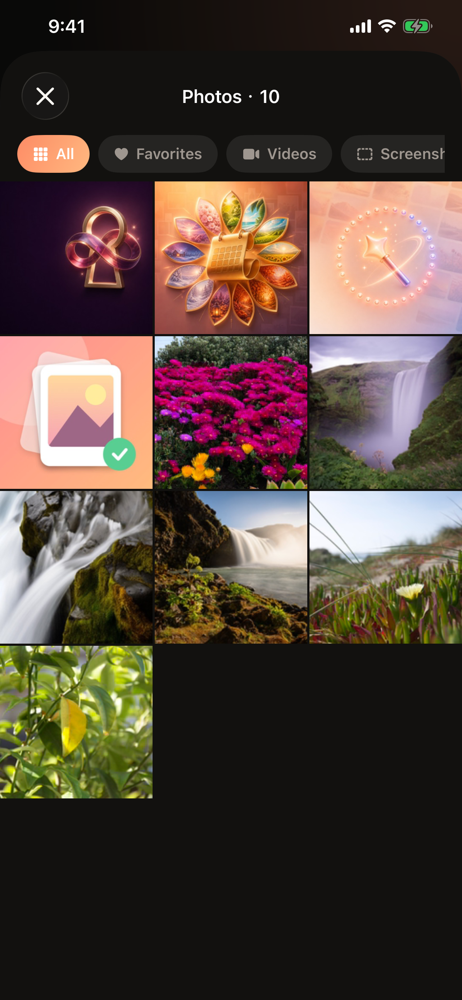

<p align="center"></p>

<h1 align="center">RollKeep · PhotoCleaner</h1>

<p align="center"><a href="README.md">English</a> · <a href="README.zh.md">中文</a> · <a href="README.ja.md">日本語</a> · <a href="README.ko.md">한국어</a></p>

iPhone, iPad, iPhone Duo용 무료 오픈 소스 사진 정리 앱입니다. 네이티브 SwiftUI로 개발했으며 구독, 앱 내 구매, 사용량 제한이 없습니다.

> RollKeep의 소스 코드, 이슈, 릴리스, 공식 웹사이트는 이 저장소에서만 계속 관리합니다.


## 기능

- 왼쪽으로 다음 사진, 오른쪽으로 이전 사진, 위로 스와이프하여 삭제 대기에 추가합니다.
- 삭제 대기 목록은 무제한이며 선택을 되돌릴 수 있습니다. 삭제에는 Apple Photos 확인이 필요합니다.
- 전체 화면 보기, 확대, 즐겨찾기, 공유, 사진 메타데이터를 지원합니다.
- 스마트 분류, 용량순 정렬, 전체 월별 타임라인으로 정리할 사진을 찾습니다.
- 기기 내 정리 통계, 예상 확보 공간, 연속 정리 일수, 최근 칠일 추세를 확인합니다.
- 창 크기에 따라 홈 화면의 열, 사진 그리드, 검토 도구를 조정합니다.
- 다섯 가지 테마와 14개 언어 옵션을 제공합니다. 지역 언어의 미번역 문구는 영어로 표시합니다.
- 사진과 메타데이터는 기기에서 처리되며 앱에서 업로드하지 않습니다.

## 빌드 및 실행

Xcode 26 이상과 iOS Simulator 런타임이 필요합니다. 실기기에서는 자신의 서명 팀을 선택하세요. iPhone Duo 검증에는 호환되는 iOS 27 런타임을 사용하세요.

```bash
git clone https://github.com/ZanwingMak/PhotoCleaner.git
cd PhotoCleaner
open PhotoCleaner.xcodeproj
```

## 미서명 IPA 빌드

`build/`에 미서명 IPA를 생성합니다. 실기기 설치 전에는 직접 서명해야 합니다.

```bash
bash scripts/build-ipa.sh
```

## 스크린샷

<p align="center">
  
  
  
</p>

인터페이스 미리보기입니다. 현재 소스에는 정리 통계와 가변 레이아웃도 포함되어 있습니다.

## 프로젝트 구조

- `PhotoCleaner/` — SwiftUI app, Photos services, and localizations.
- `PhotoCleaner.xcodeproj/` — Xcode project.
- `docs/` — GitHub Pages website, privacy policy, and terms.
- `scripts/` — Build and icon generation utilities.

## 개인정보

사진 접근은 사용자가 허용한 후에만 이루어지며 삭제에는 Apple Photos 확인이 필요합니다. 설정과 통계는 기기에 저장됩니다. GitHub Releases API 업데이트 요청에는 사진이나 사진 메타데이터가 포함되지 않습니다.

## 프로젝트 링크

- [소스 코드](https://github.com/ZanwingMak/PhotoCleaner)
- [공식 웹사이트](https://zanwingmak.github.io/PhotoCleaner/)
- [개인정보 처리방침](https://zanwingmak.github.io/PhotoCleaner/privacy.html)
- [이용 약관](https://zanwingmak.github.io/PhotoCleaner/terms.html)
- [릴리스](https://github.com/ZanwingMak/PhotoCleaner/releases)
- [이슈 및 피드백](https://github.com/ZanwingMak/PhotoCleaner/issues)
- [CHANGELOG](CHANGELOG.md)

## 라이선스

GPL-3.0-only. 모든 기능이 무료이며 자발적 후원은 기능 이용에 영향을 주지 않습니다. [LICENSE](LICENSE)
