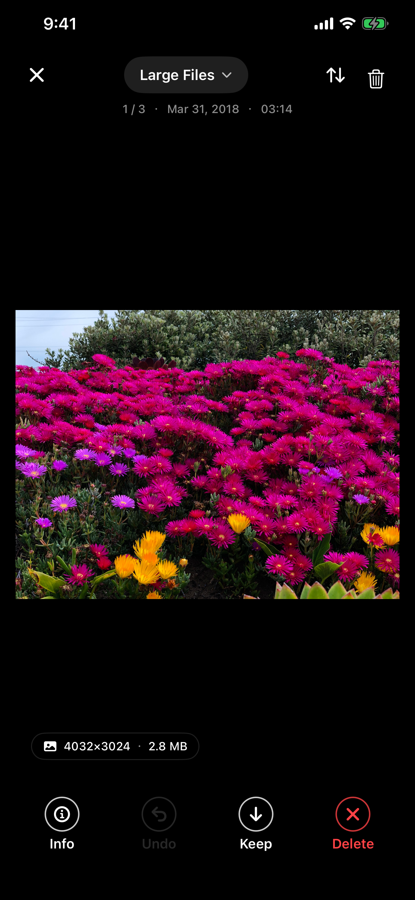
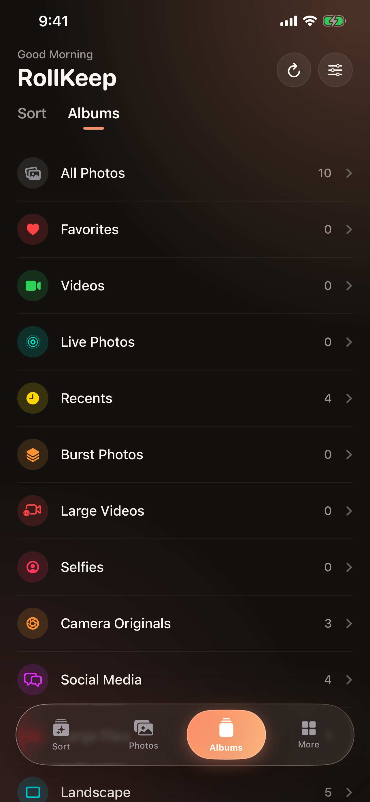

<p align="center"></p>

<h1 align="center">RollKeep · PhotoCleaner</h1>

<p align="center"><a href="README.md">English</a> · <a href="README.zh.md">中文</a> · <a href="README.ja.md">日本語</a> · <a href="README.ko.md">한국어</a></p>

Free, open-source photo organization for iPhone, iPad, and iPhone Duo, built with native SwiftUI. All features are available without subscriptions, in-app purchases, or usage limits.

> This is the only maintained repository for RollKeep. Source code, issues, releases, and the official website are maintained here.


## Features

- Swipe left for the next photo, right for the previous photo, and up to mark a photo for deletion.
- Review an unlimited pending list, undo a deletion choice, and confirm deletion through Apple Photos.
- Browse photos full screen, zoom, favorite, share, and inspect photo metadata.
- Find cleanup candidates through smart categories, largest-first sorting, and the complete monthly timeline.
- Track local cleanup totals, storage estimates, streaks, and seven-day trends.
- Use adaptive home columns, thumbnail grids, and review controls as the window size changes.
- Choose any of five themes and 14 language options. Missing regional translations fall back to English.
- Process the photo library on the device; photos and metadata are never uploaded by the app.

## Build and run

Use Xcode 26 or later with an installed iOS Simulator runtime. For a physical device, select your own signing team in Xcode. Use a compatible iOS 27 simulator runtime to verify iPhone Duo layouts.

```bash
git clone https://github.com/ZanwingMak/PhotoCleaner.git
cd PhotoCleaner
open PhotoCleaner.xcodeproj
```

## Build an unsigned IPA

The build script writes an unsigned IPA to `build/`; installation on a device requires your own signing.

```bash
bash scripts/build-ipa.sh
```

## Screenshots

<p align="center">
  
  
  
</p>

Interface previews; current source also includes cleanup insights and adaptive layouts.

## Project structure

- `PhotoCleaner/` — SwiftUI app, Photos services, and localizations.
- `PhotoCleaner.xcodeproj/` — Xcode project.
- `docs/` — GitHub Pages website, privacy policy, and terms.
- `scripts/` — Build and icon generation utilities.

## Privacy

Photo access is requested when you choose to grant it. Deletion requires Apple Photos confirmation. Preferences and cleanup statistics stay on the device. The app can query the public GitHub Releases API for version information; this request contains no photos or photo metadata.

## Project links

- [Source code](https://github.com/ZanwingMak/PhotoCleaner)
- [Official website](https://zanwingmak.github.io/PhotoCleaner/)
- [Privacy policy](https://zanwingmak.github.io/PhotoCleaner/privacy.html)
- [Terms of use](https://zanwingmak.github.io/PhotoCleaner/terms.html)
- [Releases](https://github.com/ZanwingMak/PhotoCleaner/releases)
- [Issues and feedback](https://github.com/ZanwingMak/PhotoCleaner/issues)
- [CHANGELOG](CHANGELOG.md)

## License

GPL-3.0-only. All features are free; optional donations do not unlock features. [LICENSE](LICENSE)
