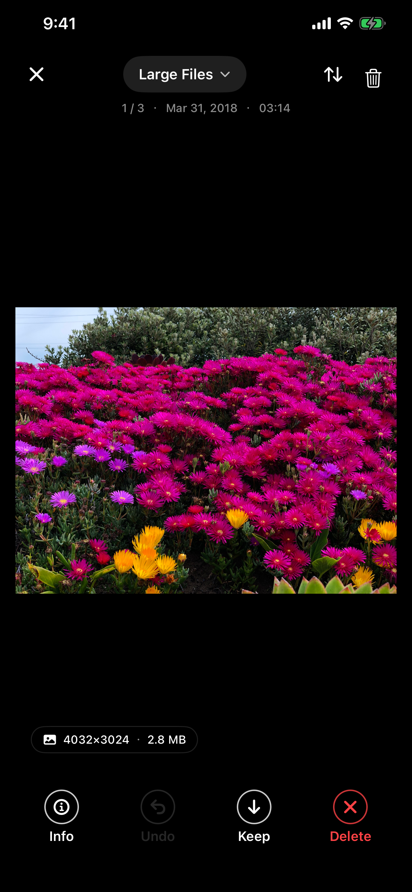
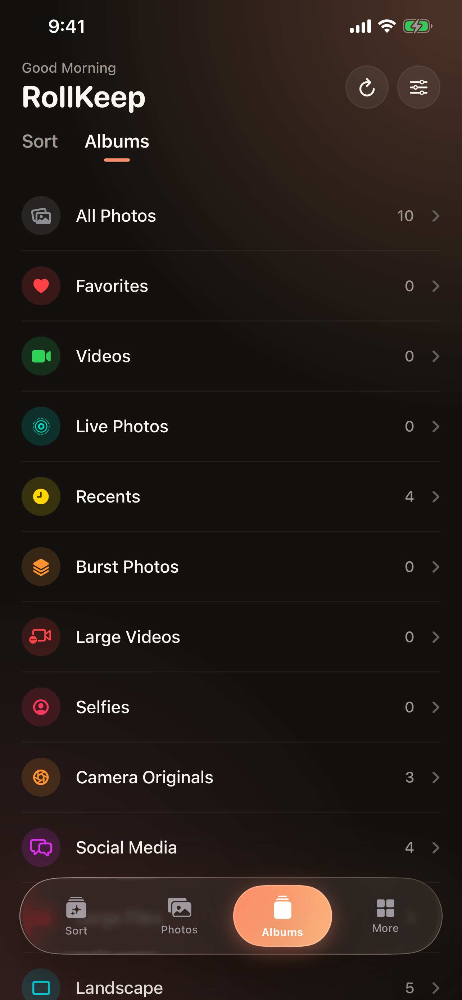
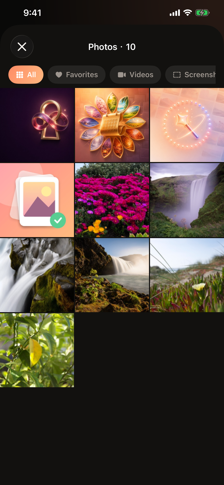

<p align="center"></p>

<h1 align="center">RollKeep · PhotoCleaner</h1>

<p align="center"><a href="README.md">English</a> · <a href="README.zh.md">中文</a> · <a href="README.ja.md">日本語</a> · <a href="README.ko.md">한국어</a></p>

适用于 iPhone、iPad 和 iPhone Duo 的免费开源照片整理工具，使用原生 SwiftUI 开发。全部功能免费，无订阅、无内购、无使用额度限制。

> 这是 RollKeep 唯一持续维护的仓库。源码、问题反馈、版本发布和官网统一在此维护。


## 功能

- 左滑下一张、右滑上一张、上滑加入待删除，快速审核照片。
- 待删除列表不限数量，支持撤销选择，最终删除仍需 Apple Photos 系统确认。
- 全屏浏览、缩放、收藏、分享照片，并查看照片元数据。
- 通过智能分类、空间优先排序和完整月份时间线找到待整理内容。
- 查看本地整理统计、预计释放空间、连续整理天数和最近七天趋势。
- 首页双栏、缩略图列数和审核工具随窗口宽度调整，支持横竖屏与分屏布局。
- 五种主题全部可用，提供 14 种语言选项，区域语言缺失的文案回退到英语。
- 照片分析在设备上完成，应用不会上传照片或照片元数据。

## 构建与运行

使用 Xcode 26 或更新版本，并安装 iOS 模拟器运行时。真机运行时在 Xcode 中选择自己的签名团队；验收 iPhone Duo 需要兼容的 iOS 27 模拟器运行时。

```bash
git clone https://github.com/ZanwingMak/PhotoCleaner.git
cd PhotoCleaner
open PhotoCleaner.xcodeproj
```

## 打包未签名 IPA

脚本将未签名 IPA 输出到 `build/`，安装到真机前需要自行签名。

```bash
bash scripts/build-ipa.sh
```

## 截图

<p align="center">
  
  
  
</p>

界面预览；当前源码还包含整理洞察和自适应布局。

## 项目结构

- `PhotoCleaner/` — SwiftUI app, Photos services, and localizations.
- `PhotoCleaner.xcodeproj/` — Xcode project.
- `docs/` — GitHub Pages website, privacy policy, and terms.
- `scripts/` — Build and icon generation utilities.

## 隐私

仅在你选择授权后访问照片库。删除操作需要 Apple Photos 系统确认。偏好和整理统计保存在本机。应用可通过 GitHub 公共 Releases API 检查版本，请求不包含照片或照片元数据。

## 项目链接

- [源代码](https://github.com/ZanwingMak/PhotoCleaner)
- [官方网站](https://zanwingmak.github.io/PhotoCleaner/)
- [隐私政策](https://zanwingmak.github.io/PhotoCleaner/privacy.html)
- [使用条款](https://zanwingmak.github.io/PhotoCleaner/terms.html)
- [版本发布](https://github.com/ZanwingMak/PhotoCleaner/releases)
- [问题与反馈](https://github.com/ZanwingMak/PhotoCleaner/issues)
- [CHANGELOG](CHANGELOG.md)

## 开源许可

GPL-3.0-only。全部功能免费，任何自愿赞助都不影响功能使用。 [LICENSE](LICENSE)
